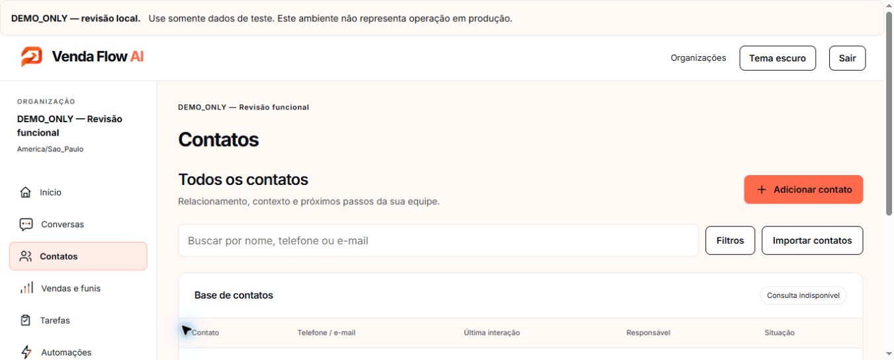

# Venda Flow AI — análise funcional

Data da revisão: 23/11/2026, America/Sao_Paulo. Base analisada: bcd4a9a e alterações desta branch de auditoria. Evidências possuem horário ISO UTC. Não foram usados banco de produção, credenciais reais de gateway, envio de mensagens ou infraestrutura de outro produto.

## Parecer

**A plataforma NÃO está 100% funcional e NÃO está pronta para produção.** Existe uma fundação real de identidade, organizações e isolamento, validada localmente. Os fluxos centrais de atendimento comercial/CRM, WhatsApp, vendas, tarefas, automações, conhecimento, relatórios, assinatura e console admin não estão implementados integralmente. Adicionar credenciais, por si só, não implementa esses domínios.

Atualização de UI: 38 HTMLs do Stitch analisados, estruturas específicas ativas no cliente e menu lateral claro. Verificação nova: 186 PASS / 0 FAIL. Detalhes, capturas e diferenças explícitas no [relatório de aplicação dos HTMLs](../../ui-ativacao/RELATORIO.md). A ativação visual não altera o veredito funcional acima.

Não atribuí um percentual de conclusão: o PRD V01–V24 está ausente e não existe uma base completa de critérios rastreáveis. Contagem de testes aprovados, menus e screenshots não é percentual de funcionalidades concluídas. As telas de indisponibilidade são estados honestos, não operações de negócio.

## Matriz de funcionalidades

LOCAL_OK significa comprovado apenas no ambiente local de teste, com dados DEMO_ONLY e PostgreSQL real. PARCIAL significa capacidade incompleta ou ainda sem validação externa. NAO_IMPLEMENTADO significa ausência do fluxo/domínio no código disponível. NAO_VALIDADO não permite conclusão sobre ambiente externo.

| Capacidade | Situação | Evidência / limite |
| --- | --- | --- |
| Site público | PARCIAL | Landing e navegação funcionam. Catálogo de planos/preços e documentos jurídicos não estão disponíveis. |
| Login e sessão | LOCAL_OK / EXTERNO_NAO_VALIDADO | Fluxo OIDC/PKCE/JWS, cookie HttpOnly/Secure/SameSite, CSRF e logout testados com IdP local assinado. Nenhum IdP externo foi validado. |
| Cadastro e recuperação de acesso | PARCIAL | Telas de encaminhamento ao provedor; sem confirmação de cadastro/reset em provedor real. |
| Organizações e onboarding inicial | LOCAL_OK | Criar, selecionar, consultar e atualizar nome/fuso; pt-BR/BRL; persistência PostgreSQL real. Não conclui ativação de canal ou assinatura. |
| Tenancy e autorização | LOCAL_OK | Roles owner/admin/manager/agent/viewer/billing, membership e RLS FORCE; provas de isolamento A/B, viewer 403, idempotência e revogação. |
| Equipe | PARCIAL | API gerencia memberships e UI consulta acessos. Sem convites por e-mail, nomes/e-mails ou gestão completa pela interface. Lista limitada a 100. |
| Atendimento e conversas | NAO_IMPLEMENTADO | UI de três colunas ativa, com filtros, compositor de rascunho e contexto. Sem API de conversas, fila operacional, histórico, envio, atribuição ou resolução. |
| WhatsApp Business Platform oficial | NAO_IMPLEMENTADO | Sem conexão Meta, canal verificado, templates, janela de envio, mensagens ou webhooks oficiais. Nenhuma mensagem real foi enviada. |
| Contatos e CRM | NAO_IMPLEMENTADO | Sem CRUD de contatos, busca, importação, segmentação, deduplicação ou histórico comercial. |
| Vendas, funis e oportunidades | NAO_IMPLEMENTADO | Sem domínio/CRUD de oportunidades, etapas, tarefas associadas ou valores comerciais confirmados. |
| Tarefas | NAO_IMPLEMENTADO | Sem backend de tarefas, responsáveis, prazos, conclusão ou lembretes operacionais. |
| Automações | NAO_IMPLEMENTADO | UI com modelos e wizard de três etapas, rascunho apenas em memória. Sem backend de publicação, avaliação de consentimento, agendamento, execução ou pausa de fluxos. |
| Conhecimento, IA e RAG | NAO_IMPLEMENTADO | Sem ingestão, base de conhecimento operacional ou inferência/assistência real. |
| Relatórios e receita | NAO_IMPLEMENTADO | Sem agregações comerciais, indicadores ou distinção operacional entre proposta/ganho/receita liquidada. Nenhum número comercial é inventado. |
| Assinatura Mercado Pago | NAO_IMPLEMENTADO | Somente fronteiras/ports. Sem checkout real, catálogo, entitlement, cancelamento, webhook, faturas ou reconciliação. |
| Consentimento, privacidade e DSAR | NAO_IMPLEMENTADO | Sem registro operacional por finalidade/canal, revogação ou atendimento DSAR. Termos/política aprovados e canais oficiais ausentes. |
| Console administrativo interno | NAO_IMPLEMENTADO | Existem referências visuais em sandbox; não há venda-admin/venda-admin-api funcional, identidade interna e MFA validados. |
| Outbox/inbox | PARCIAL | Persistência atômica e deduplicação testadas. Sem publisher, consumer de negócio, SQS/DLQ ou workers operacionais. |
| Auditoria e observabilidade | PARCIAL | Auditoria append-only e OTLP em collector de teste. Web Vitals local; sem collector RUM ou operação observada em produção. |
| Acessibilidade e marca | PARCIAL | Inter/tokens e testes automatizados/teclado locais. Sem certificação WCAG integral/tecnologia assistiva; SVG oficial e aprovação de arte pendentes. |
| Implantação e operação | NAO_VALIDADO | Sem evidência neste repositório de operação AWS produtiva, restore de backup/DR, WAF/HSTS, scanning CI e carga produtiva acordada. |

Fonte de código principal: venda-api/src/app.ts, migrations/001_foundation.up.sql, venda-web/lib/api.server.ts, venda-web/lib/modules.ts e venda-web/app/(workspace)/app/o/[organizationId]/[[...section]]/page.tsx. Há 31 entradas no catálogo de rotas cliente/público; isso não representa 31 fluxos comerciais concluídos. Os detalhes de objetos comerciais sem contrato continuam 404. As referências de admin em Storybook/sandbox não constituem um console administrativo operacional.

## Testes desta revisão

- Frontend: 16 testes aprovados; 0 falhas, em evidencias/unitarios-web.json.
- Regressão UI: 20 aprovados; 0 falhas, em evidencias/regressao-ui.json.
- Backend: suíte com 28 casos, PostgreSQL nativo real, JUnit em evidencias/backend-resultados.xml. Resultado do processo em comandos.json.
- Integração inicial: 123 PASS e 1 FAIL; o cenário novo identificou perda do rascunho após falha de alteração.
- Integração final: 124 PASS e 0 FAIL; PASS no escopo testado. Evidência em evidencias/integracao-final/browser.json.
- IdP de teste assinado RSA/JWKS, nunca confundido com provedor OIDC externo. Cookie e CSRF em loopback confiável não comprovam TLS/MFA produtivos.

| Comando/check | Resultado (exit) | Duração |
| --- | --- | --- |
| unitarios-web | PASS (0) | 8.5 s |
| regressao-ui | PASS (0) | 15.3 s |
| build-backend | PASS (0) | 12.7 s |
| compile-testes-backend | PASS (0) | 9.9 s |
| testes-backend | PASS (0) | 58.4 s |
| build-web | PASS (0) | 97.4 s |
| integracao-inicial | FAIL (1) | 161.2 s |
| unitarios-web-final | PASS (0) | 3.6 s |
| regressao-ui-final | PASS (0) | 12.5 s |
| build-web-final | PASS (0) | 63.2 s |
| integracao-final | PASS (0) | 155.3 s |

Comandos exatos, cwd, duração e saída redigida estão em evidencias/comandos.json e logs. Para reproduzir: npm run audit:platform; após uma correção, npm run audit:platform -- --retest. Testes usam fixtures descartáveis; o launcher de revisão cria outro banco isolado após o término dos testes. Evidências antigas da etapa 04 foram preservadas, não reclassificadas como execuções de hoje.

## Defeito encontrado e corrigido

Ao editar uma organização e interromper a API, a Server Action devolvia erro, mas o reset automático do formulário removia o texto digitado. O banco permanecia sem a alteração. A revisão acrescentou um teste que checa simultaneamente o rascunho na interface e o nome persistido no PostgreSQL. A correção cancela o reset nesse formulário; sucesso continua redirecionando para o estado confirmado. A intenção idempotente permanece a mesma.

Há evidências anteriores e posteriores da correção, sem esconder a falha inicial. Outros limites conhecidos: paginação de memberships e identificação da própria capacidade, convites/nomes ausentes, edição concorrente e auditoria assistiva completa ainda exigem trabalho.

## Sondagem da API durante a demonstração

Requisições locais feitas com sessão autenticada criada pelo protocolo OIDC e API reais. Nenhuma sessão foi inserida diretamente em SQL. Resultados em preview.json.

| Endpoint | HTTP |
| --- | --- |
| /health | 200 |
| /ready | 200 |
| /v1/me | 200 |
| /v1/openapi.json | 200 |
| /v1/contacts | 404 |
| /v1/conversations | 404 |
| /v1/opportunities | 404 |
| /v1/workflows | 404 |
| /v1/knowledge | 404 |
| /v1/reports/overview | 404 |

Os seis endpoints comerciais de referência não estão no controller/contrato candidato. Um 404 autenticado, combinado com a leitura de código, confirma ausência da operação neste repositório. Não se confunde isso com integração apenas aguardando credenciais.

## Segurança, desempenho e evidências externas

Consultas atuais npm audit nesta revisão: frontend 0 vulnerabilidades conhecidas, backend 0. Os JSON originais estão em npm-audit-web.json e npm-audit-api.json. Isso não substitui testes de aplicação, SAST/DAST ou avaliação ASVS completa.

Verificados localmente: RLS FORCE sob role sem bypass, contexto de transação, isolamento A/B por path/body/query/header, viewer 403, membership revalidado, sessão/cookies/CSRF, idempotência concorrente, outbox/inbox e auditoria append-only, logs por allowlist, prazo de headers/corpo e falhas de rede. A aprovação se limita aos casos/dataset executados; não é certificação ASVS nem prova de ausência de regressões.

RUM de campo, INP por segmento, carga real, DNS/TLS, proxy confiável, backup restaurável e operação AWS não foram certificados. As métricas Lighthouse da etapa 04 são de 21/11, laboratório local, e permanecem históricas: LCP p75 landing aproximadamente 297ms desktop e 897ms mobile simulado; TBT mobile 567ms, risco de interatividade. Não foram apresentadas como medições novas nem garantia de um segundo. A rodada de navegador de hoje mede FCP/TTFB local, com condições em integracao-final/performance.json; isso também não substitui dados de campo.

As referências canônicas ausentes são: referencias/00_ARQUITETURA_GERAL.md, referencias/03_SEGURANCA_E_GOVERNANCA.md, referencias/venda-openapi.yaml; PRD V01–V24 também não foi fornecido. O GitHub conectado foi consultado nesta revisão e respondeu que o repositório está vazio. Não houve push/deploy. Nenhuma estatística comercial, preço, receita ou cliente real foi inventado.

## Plataforma rodando no Chrome

URL local: http://127.0.0.1:3400. O ambiente tem faixa DEMO_ONLY, PostgreSQL descartável real e IdP de protocolo simulado. A organização de teste chama-se DEMO_ONLY — Revisão funcional. O usuário consegue percorrer a fundação disponível; módulos ausentes continuam identificados como indisponíveis.

Inicialização: npm run review:local. O launcher exige --demo-only, embutido nesse comando, restringe serviços a 127.0.0.1 e não usa credenciais produtivas. Ctrl+C no processo encerra Next, API, IdP e remove seu banco temporário. Nenhum dado desse ambiente deve ser usado em operação real. A inspeção do Chrome visível é registrada separadamente em evidencias/chrome.json; capturas headless são identificadas como teste automatizado.

## Prioridades para operação real

**P0:** reconciliar PRD/arquitetura/OpenAPI/segurança; concluir domínios comerciais com contratos e testes; integrar WhatsApp oficial; integrar assinatura/entitlements Mercado Pago e reconciliação; validar identidade externa, cadastro/reset e admin/MFA; publicar documentos legais e fluxos de consentimento/DSAR; validar isolamento e credenciais em sandbox de provedores, TLS/proxy e operação/backup.

**P1:** resolver limites de paginação/equipe/concorrência; validar acessibilidade assistiva e dispositivos reais; aprovar SVG/baselines de arte; instrumentar RUM e carga com budgets por rota; testar incidentes, retries/DLQ e recuperação.

**P2:** atalhos/busca e otimizações de alto volume após implementação dos módulos e disponibilidade de dados reais.

## Aceite desta auditoria

PASS para a análise baseada no código/testes e para a demonstração local quando as evidências finais estiverem aprovadas. FAIL para a afirmação “plataforma 100% funcional” e para liberação produtiva. N/A para testes reais de cobrança/envio Meta, pois não há integrações operacionais. Nenhum endpoint, preço ou resultado de produção foi criado para preencher lacunas. Esta auditoria não executou automaticamente a etapa 05.
