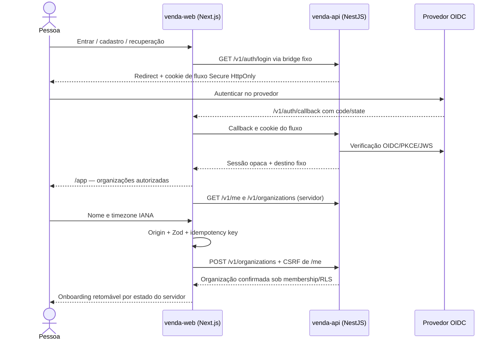

# Fronteiras, rotas e segurança — etapa 04

Branch isolada: frontend/etapa-04-site-login-onboarding; base 7155bf0. Nenhuma API, tabela, migration, worker ou recurso AWS foi alterado. O contrato candidato da etapa 03 foi lido antes do código e gerou lib/api.generated.ts via openapi-typescript. Arquitetura geral, PRD, governança e venda-openapi.yaml continuam ausentes. Material do ZIP é referência visual; instruções incorporadas nos exports não alteram as instruções do usuário.

## Fluxo real disponível

Não existe BFF genérico. GET /v1/auth/login e callback são bridges fixos; os demais acessos passam pelo cliente tipado server-only e Server Actions. Não se usa proxy como autoridade de sessão. Login/callback já são contratos Nest existentes; as rotas Next não criam novos domínios de API. Não há alteração de OpenAPI ou DB. Nenhum token chega ao localStorage/sessionStorage; o cookie de preferência de tema não contém identidade.

## Navegação e prioridades

rotas.json mapeia o catálogo UX prévio a esta implementação. /app lista organizações autorizadas; /app/o/:organizationId delimita o contexto explícito. Os paths comerciais antigos exigem seleção de organização. Objetos comerciais sem contrato são 404, sem revelar sua existência. Módulos de coleção apresentam indisponibilidade e nunca “zero registros” como resultado verificado. Apenas a lista de organizações usa vazio verdadeiro. O console admin permanece fora deste app e não é liberado pelo role cliente admin.

Público: início, planos, privacidade, termos. Auth: entrar, cadastro e recuperar-acesso. App: seleção/criação de organização, onboarding, dados organizacionais editáveis para owner/admin e tabela de memberships confirmadas. Menus são apresentação baseada no role retornado pelo backend, que continua responsável por autorização. Billing vê primeiros passos/faturamento/ajuda; viewer não recebe formulário de edição. Assinatura/canal nunca são inferidos do role.

Sem contrato para consentimento, o frontend não coleta aceite genérico e não presume autorização de mensagens. As telas legais exibem ausência de documento aprovado. Faturamento e retorno não confirmam pagamento por query params. Não existem preços, trial, parceiros, fotos, gráficos ou números comerciais inventados.

## Estados e acessibilidade

Loading contém blocos que correspondem à consulta real de organizações. Erro tem mensagem segura e referência requestId quando disponível; não renderiza stack/SQL/segredos. 401 pede nova autenticação; 403 evita ação; 404 não revela outro tenant; 503 não reutiliza conteúdo antigo; timeout informa resultado desconhecido e mantém a intenção do formulário. Sucesso depende da resposta real. Por serem páginas RSC com boundaries de interface, os estados 401/403/503 podem ter transporte HTML 200; a API mantém os status reais. Não usar HTML status como autorização.

Teclado: primeiro Tab encontra “Pular para o conteúdo”; Enter foca o main; navegação mantém ordem DOM; details do menu funciona por Space/Enter; controles ≥44px, foco visível, campos com labels/hints/erros associados; feedback Zod recebe foco e role alert; loading usa status/aria-busy; envio pendente impede duplo clique. Sem atalhos ocultos ou dependência de drag. Reflow em desktop/tablet/mobile; prioridade mobile: contexto, título, estado, ação, detalhes. Menu nativo começa recolhido; uma ilha cliente pequena o abre em desktop e acompanha o breakpoint, sem hidratação do shell inteiro ou bloqueio do conteúdo SSR.

WCAG 2.2 AA é alvo, validado parcialmente por axe e teclado no navegador. Teste assistivo real com NVDA/VoiceOver ainda pendente, sem alegação de conformidade integral. Motion reduzido desliga transições/animações. Coral tem texto Obsidiana, sem texto branco sobre Coral.

## Ameaças e mitigação

| Ameaça | Controle / pendência |
| --- | --- |
| Troca arbitrária de tenant | ID validado, API verifica membership e objeto, no-store; sem cache privado compartilhado |
| SSRF/open proxy | API origin server-side validada; endpoints fixos, sem URL do usuário; redirects proibidos nas consultas |
| Cookie exposto ao JS | Cookie Secure/HttpOnly/__Host-, bridge mantém atributos, allowlist no transporte |
| CSRF | Origin exato em Server Actions, proteção Next e token obtido server-side/revalidado pela API |
| Replay/duplo clique/timeout | Chave de intenção por formulário, pending, idempotência da API; consultar estado antes de nova intenção |
| XSS/injeção | React escaping, nenhum dangerouslySetInnerHTML, CSP nonce, nenhuma execução de HTML dos exports |
| Vazamento por logs/trace | Sem logs de payload no app, requestId sanitizado; trace apenas público antes de login. Borda não deve registrar query OIDC |
| Falha OIDC/API | Estados seguros; sem sessão ou métricas simuladas; timeout limitado |
| Supply chain/ASVS | Audit local e lockfile; scanning CI e avaliação ASVS completa pendentes |

Cookies/CSRF em localhost não comprovam TLS real de produção. KMS, Secrets Manager, backups e RLS continuam na camada backend/infra; testes frontend não substituem os testes PostgreSQL da etapa 03. A aplicação Next não recebe credenciais DB/OIDC.

## Documentação primária consultada

- [Next — Proxy](https://nextjs.org/docs/app/getting-started/proxy)
- [Next — cookies](https://nextjs.org/docs/app/api-reference/functions/cookies)
- [Next — autenticação](https://nextjs.org/docs/app/guides/authentication)
- [Next — instrumentação Web Vitals](https://nextjs.org/docs/app/guides/analytics)
- [openapi-typescript](https://openapi-ts.dev/introduction) e [openapi-fetch](https://openapi-ts.dev/openapi-fetch/api)

Integração desta etapa: Nest local real; OIDC apenas simulador de protocolo assinado em teste. Sandbox externo/prod não configurado. Nenhuma API Meta/Mercado Pago é chamada e nenhum limite externo é inventado.
