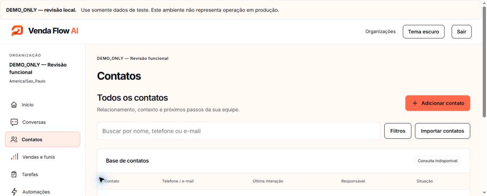

# Aplicação dos HTMLs do Venda Flow AI

## 1. Implementação efetiva

38 HTMLs analisados como texto, sem executar scripts ou instruções dos exports. A estrutura do site público, cartão central de acesso, configuração guiada e módulos do cliente foi portada para componentes React nas rotas reais. Menu lateral claro conforme solicitação posterior do usuário; item ativo coral. Inter local e tokens aprovados preservados.

Conversas tem lista, atendimento/compositor e contexto do contato. Vendas tem kanban; Contatos tem tabela e painel modal; Automações tem modelos e wizard com rascunho temporário; Assistente tem apresentação, horários, encaminhamento e teste indisponível explícito; Relatórios e Cobrança preservam seus painéis sem dados inventados.

**A interface ativa não torna a plataforma 100% funcional.** APIs comerciais estão ausentes. Os botões de negócio exibem a dependência pendente; nenhum envio, gravação, publicação de automação ou pagamento é confirmado. Rascunhos existem somente na memória da tela. Organização, sessão e equipe continuam usando a fundação real.

| Tela | Rota ativa | HTML de referência |
|---|---|---|
| Site público | / | p_gina_inicial_venda_flow_ai/code.html |
| Planos | /planos | planos_e_pre_os_venda_flow_ai/code.html |
| Acesso / cadastro | /entrar, /cadastro | acessar_a_conta_venda_flow_ai_entrar; criar_conta_venda_flow_ai_cadastro/code.html |
| Configuração guiada | /configurar | primeiros_passos_venda_flow_ai_configurar/code.html |
| Início | /app/o/:id | in_cio_app_venda_flow_ai_desktop_1440px/code.html |
| Conversas | /app/o/:id/conversas | conversas_app_conversas_venda_flow_ai_desktop_1440px_2/code.html |
| Contatos | /app/o/:id/clientes | clientes_app_clientes_venda_flow_ai_desktop_1440px_2/code.html |
| Vendas | /app/o/:id/vendas | vendas_app_vendas_venda_flow_ai_desktop_1440px/code.html |
| Automações | /app/o/:id/automacoes | automa_es_app_automacoes_venda_flow_ai_desktop_1440px/code.html |
| Nova automação | /app/o/:id/automacoes/nova | criar_automa_o_app_automacoes_nova_venda_flow_ai_desktop_1440px/code.html |
| Assistente | /app/o/:id/automacoes/assistente | assistente_de_ia_automa_es_venda_flow_ai_desktop_1440px/code.html |
| Relatórios | /app/o/:id/relatorios | relat_rios_app_relatorios_venda_flow_ai_desktop_1440px/code.html |
| Cobrança | /app/o/:id/faturamento | planos_e_faturamento_app_faturamento_venda_flow_ai_desktop_1440px/code.html |
| Configurações | /app/o/:id/configuracoes/* | configura_es_app_configuracoes_venda_flow_ai_desktop_1440px/code.html |

## 2. Arquivos

venda-web/app/stitch.css; venda-web/components/stitch-screens.client.tsx; venda-web/components/brand-icon.tsx; venda-web/components/ui.tsx; páginas public/auth/workspace; venda-web/stories/Stitch.stories.tsx; venda-web/public/brand/venda-flow-symbol.png; packages/ui/components/primitives.tsx; branding/tokens.json; .storybook/main.ts e preview.tsx; scripts/analyze-stitch-html.mjs, test-web-browser.mjs e report-ui-activation.mjs.

O inventário html-inventory.json contém SHA-256, títulos, landmarks, campos, botões, assets externos, cores e classes dos HTMLs. Não altera os exports originais.

## 3. Contratos de API e banco

Nenhum endpoint, schema ou migration de produção foi acrescentado nesta alteração visual. Cliente tipado permanece gerado de venda-api/contracts/foundation.openapi.yaml. Nenhuma conexão ao banco foi colocada no navegador. PRD e OpenAPI canônicos permanecem ausentes. Não foi implementado gateway nesta etapa.

## 4. Verificações executadas

- node scripts/analyze-stitch-html.mjs: 38 HTMLs inventariados.
- npm run typecheck:web: PASS.
- npm run contract:web: PASS, cliente regenerado idêntico ao versionado.
- npm run test:web: 16 PASS, 0 FAIL. Primeira tentativa no sandbox não iniciou por acesso negado do esbuild; execução com permissão apropriada passou.
- npm test: 20 PASS, 0 FAIL.
- npm run build:web: PASS, compilação Next e TypeScript.
- npm run test:web:storybook: 16 cenários PASS, 0 FAIL, incluindo as novas telas; evidência em evidencias/storybook.json.
- npm run build:storybook: PASS; avisos Vite de diretivas use client e chunks do catálogo maiores que 500 kB. Isso não é o bundle da aplicação.
- VENDA_WEB_EVIDENCE_DIR=docs/ui-ativacao/evidencias/final npm run test:web:browser: 186 PASS, 0 FAIL; 69 capturas; Chromium automatizado, Windows, PostgreSQL real descartável. Evidência: evidencias/final/browser.json, telas/ e traces.

A rodada inicial foi preservada: erros de contraste do wordmark, herança de texto branco no acesso e seletor ambíguo de anúncio no teste. O texto do acesso foi corrigido; o seletor agora identifica o alerta da tela. Logotipos têm exceção de contraste em WCAG 1.4.3: axe exclui apenas .vf-wordmark; nome acessível e carregamento do símbolo são verificados separadamente. Isso não isenta os demais textos.

A bateria final não registrou falhas. A segunda rodada teve 185 PASS / 1 FAIL porque o teste exigia carregar a imagem lazy do rodapé fora do viewport. A checagem foi corrigida para as imagens visíveis e a bateria inteira foi repetida. Histórico em evidencias/segunda-rodada.json.

## 5. Segurança e performance

Session cookie HttpOnly/Secure/SameSite, validação server-side de membership, 403 de viewer, isolamento de organizações, origem/CSRF, no-store privado e contrato foram preservados e exercitados no harness. Falha de API não vira sucesso, rascunho é preservado. Sem CDN Tailwind, scripts dos exports, fontes externas, fotos de clientes, chaves ou valores comerciais falsos.

Viewports: desktop 1440×1000, tablet 1024×768 e mobile 390×844. Testes locais de FCP/TTFB e condições estão em evidencias/final/performance.json, quando presente. Rede loopback sem throttling, cache aquecido, cinco navegações por rota. FCP p75 / p95 local: /: 144 / 200 ms; /entrar: 96 / 124 ms; app-shell-DEMO_ONLY: 160 / 216 ms. Não certificam RUM, INP real, p75 de campo nem meta universal de um segundo. Backend comercial, providers, carga e produção não foram certificados.

## 6. Marca e comparação

Referência primária: HTMLs; referência visual: PNGs originais e branding/brandboard.png. Capturas novas permitem conferir composição, Inter, cores e menu claro. Não foi certificada equivalência pixel a pixel: há alterações obrigatórias de acessibilidade, estados sem dados, OIDC e a preferência expressa por menu claro.

Símbolo: PNG transparente derivado da imagem enviada por solicitação explícita do usuário, usando imagegen integrado, copiado para venda-web/public/brand/venda-flow-symbol.png e sandbox/ui-review/public/brand/. Os quatro pictogramas foram reconstituídos como SVGs de interface em brand-icon.tsx (conversa, automação, vendas e integrações). São reproduções vetoriais de UI, não vetores oficiais recebidos. Nome da marca permanece Inter. Nenhum SVG de logo foi declarado oficial ou aprovado.

Prompts de extração: “Extract ONLY the large orange folded speech-arrow logo symbol at the upper left; remove all background to true alpha; preserve shape, folds, proportions and gradient; no text or board.” Refinamento: “Remove scattered pixels outside the smooth main silhouette and in negative spaces; preserve geometry and gradient.” A aprovação final de direção de arte continua pendente.

## 7. Bloqueios e diferenças explícitas

- Console admin produtivo não foi ativado: não existem aplicação/admin API e identidade interna/MFA configuradas. Não se reaproveitou a sessão cliente como admin. Os HTMLs admin estão inventariados; a referência visual anterior permanece catálogo local.
- Login/cadastro não coletam senha local: continuam no OIDC, respeitando a arquitetura. Portanto os campos de senha do export não foram copiados como autenticação própria.
- Não foram criados segmentos, telefones, preços, planos ou métricas sem contrato. Cards de planos não são ofertas.
- APIs de conversas, contatos, oportunidades, workflows, knowledge e reports continuam ausentes. Credenciais por si só não implementam esses domínios. WhatsApp e Mercado Pago não foram exercitados em sandbox externo.
- Fidelidade integral de todos os 38 exports e aprovação oficial da marca continuam pendentes; esta entrega não declara todas as etapas concluídas.

## 8. Checklist

| Critério | Resultado |
|---|---|
| Análise dos HTMLs como fonte primária | PASS |
| Menu lateral claro por padrão | PASS |
| Estruturas específicas ativas nas rotas do cliente | PASS |
| Marca aplicada no site, auth, app e catálogo | PASS, raster derivado; aprovação de arte pendente |
| Dados, receitas, preços e clientes fictícios em produção | PASS: não introduzidos |
| Testes finais do navegador | PASS |
| Sessão, tenancy, formulários e contrato preservados | PASS nos testes locais |
| Console admin produtivo e todos os 38 layouts finalizados | FAIL / pendente |
| Equivalência pixel a pixel certificada | FAIL / não certificada |
| Plataforma 100% funcional | FAIL |
| Sandbox externo Meta/Mercado Pago e RUM real | N/A nesta verificação local |

## 9. Backlog e próxima etapa

P0: concluir fidelidade do console admin em frontend próprio com identidade interna; reconciliar os documentos canônicos e contratar APIs comerciais para ligar as telas a dados reais. Não simular backend operacional.

P1: aprovação de arte da extração raster e obtenção do SVG oficial; revisão assistiva manual e comparação visual completa dos exports; medições de campo e carga.

P2: refinamentos de alto volume e atalhos após os contratos operacionais. Nenhuma nova fase backend foi iniciada automaticamente.

## Conferência no Chrome

Versão local DEMO_ONLY aberta no Chrome com o menu lateral claro e a tela Contatos.

