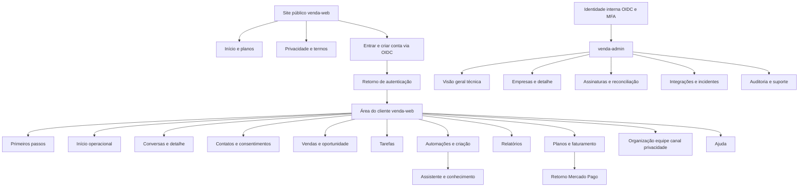

# Arquitetura da informação

## Sitemap proposto e limites

routes.json é o catálogo de rotas candidatas desta etapa, com papel, prioridade, wireframe, estados e fonte. IDs são identificadores documentais; `:id` representa objeto imutável do contrato futuro. Não são IDs fictícios de produção. P0 significa necessário para o fluxo seguro proposto; P1/P2 são complementos a validar. Nenhuma rota está implementada. Cobertura do PRD é indeterminada até obter V01–V24.

Cliente e console interno pertencem ao produto Venda Flow AI, mas têm sessões, públicos, autorização e APIs próprios. Admin não é uma aba do cliente, nem a assinatura do cliente concede acesso interno. Não compartilhar identidades com outro produto. Domínios de produção não definidos; nenhum domínio inventado.

## Navegação por papel proposto

| Papel | Entrada e itens visíveis | Atalhos contextuais | Exclusões |
| --- | --- | --- | --- |
| Visitante | Início, planos, entrar, criar conta, privacidade, termos | Comparar capacidades verificadas | Nenhum dado de tenant |
| Responsável da organização | Primeiros passos ou início; todos os módulos cliente autorizados | Conectar canal, equipe, faturamento | Console interno |
| Gestor | Início, conversas da equipe, contatos, vendas, tarefas, relatórios; automações se autorizado | Atribuir, filtrar, revisar automação | Cobrança e gestão de membros sem capacidade explícita |
| Atendente | Minhas conversas, contatos permitidos, minhas oportunidades/tarefas | Responder, registrar atividade, transferir conforme política | Exportações globais, cobrança, publicação de automações |
| Financeiro | Faturamento e ajuda; perfil/sessão | Revisar cobrança e renovar | Conteúdo de conversas e contatos |
| Suporte interno | Login interno, saúde técnica, empresas mínimas, auditoria permitida | Abrir diagnóstico com motivo | Corpo de conversas, exportação, cobrança manual |
| Operação financeira interna | Assinaturas e reconciliação, trilha restrita | Consultar estado confirmado | Conceder acesso arbitrariamente ou marcar pagamento sem confirmação |
| Auditor interno | Auditoria somente leitura, escopo explicitado | Filtrar evento por correlation ID | Operações mutáveis e dados desnecessários |

Nomes de papéis são propostas UX, não enumerações existentes do PRD/RBAC. Capacidades serão reconciliadas com contrato. Papel não substitui membership ativo, escopo do objeto ou entitlement server-side.

## Taxonomia e busca

Usar “Contatos” como entidade e menu “Contatos” (exports chamam “Clientes”); explicar que um contato não representa cliente convertido. “Vendas” abre funis/oportunidades; status ganho é declaração comercial, não liquidação bancária. “Tarefas” são próximas ações com responsável e prazo, independentes de mensagem enviada. “Automações” são regras autorizadas, e “Assistente de IA” é uma capacidade contextual sob automações, com revisão humana.

Busca é local ao módulo e ao tenant, com filtros refletidos na URL sem telefone, texto de conversa ou token. URLs de detalhes usam IDs opacos; nomes não são identificadores. Manter filtro, seleção e posição ao voltar, respeitando revogação de acesso. Troca de organização limpa caches, rascunhos não salvos e subscrições; avisar e permitir salvar antes da troca quando seguro. Nenhum conteúdo de tenant anterior aparece no novo shell.

404 e acesso por objeto devem evitar revelar existência de objeto de outro tenant. 401 preserva apenas destino interno seguro para retomar após login. Expiração não deve colocar conteúdo sensível em query string. Sessão revogada limpa interface e pede autenticação.

## Proveniência das rotas

Cada export foi associado a uma rota ou marcado como referência de marca no inventário. Variantes desktop/mobile e `_1`/`_2` não criam rotas duplicadas. Detalhes de conversa/contato, tarefas, privacidade e callbacks são complementos propostos para fechar jornadas; sua existência e sintaxe devem ser validadas contra PRD e OIDC. Não renomear URLs de uma aplicação existente com base neste catálogo sem verificar compatibilidade.
