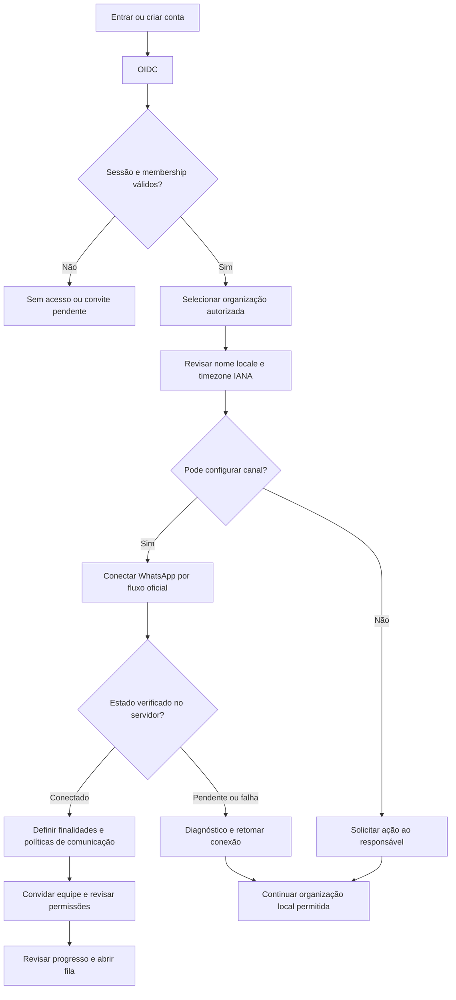
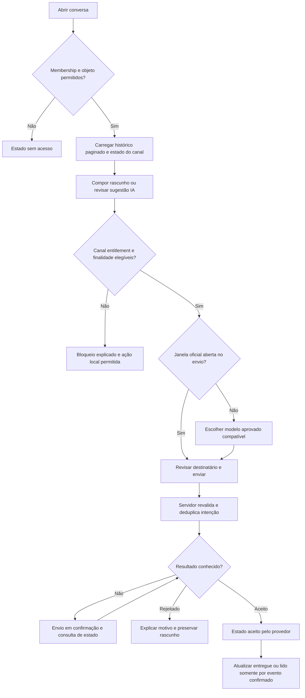
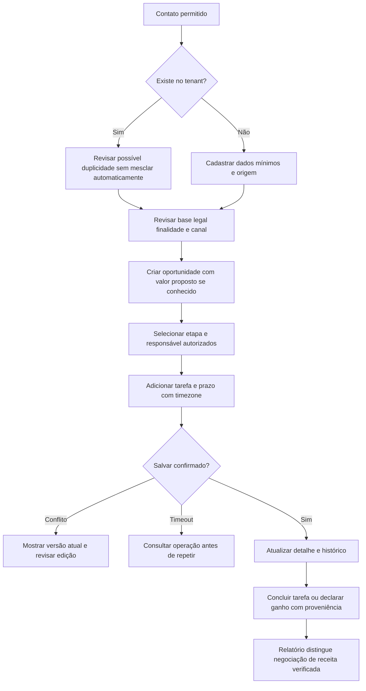
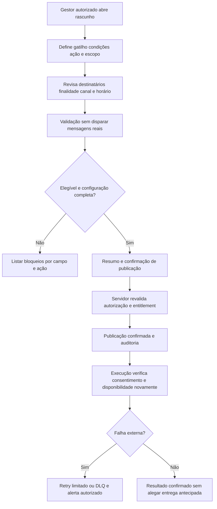
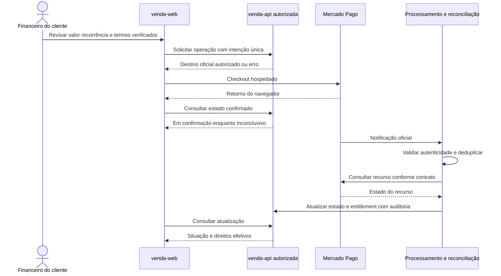
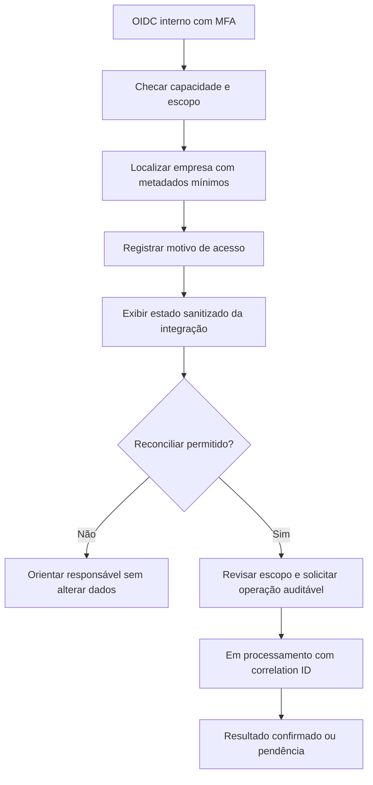

# Jornadas e fluxos essenciais

Todos os fluxos são especificações propostas. Estados E0–E6 e recuperação estão em 04-wireframes-e-estados.md; guards de segurança em 05-permissoes-e-integracoes.md. Nenhum fluxo representa integração executada.

## Jornadas por papel

| Papel | Gatilho e percurso | Momento de risco | Resultado e recuperação |
| --- | --- | --- | --- |
| Visitante | Entender produto → conferir planos verificados → entrar/cadastrar com OIDC | Preço indisponível ou consentimento genérico | Sem preço inventado; permitir conhecer capacidades e retomar contratação depois |
| Responsável | Autenticar → criar/selecionar organização autorizada → timezone → canal oficial → equipe → revisar setup | Conta Meta sem permissão; setup interrompido | Salvar progresso confirmado; canal fica pendente e CRM local continua acessível conforme entitlement |
| Gestor | Ver fila → filtrar pendências → atribuir → acompanhar tarefa e oportunidade → analisar relatório | Conflito de atribuição ou troca de organização | Atualizar responsável confirmado e oferecer revisão do estado atual |
| Atendente | Abrir conversa permitida → contexto/consentimento → responder → registrar próxima ação → resolver | Janela expira durante composição; timeout de envio | Preservar rascunho seguro; consultar estado antes de reenviar; modelo autorizado se elegível |
| Financeiro | Conferir plano e preço → revisar recorrência → Mercado Pago → aguardar reconciliação → consultar fatura | Retorno enganoso ou pagamento duplicado | Estado em confirmação; acesso somente após decisão server-side; nova tentativa sem duplicar operação |
| Suporte interno | MFA → localizar empresa mínima → declarar motivo → diagnóstico → orientar recuperação | Exposição de conteúdo do cliente | Mostrar apenas metadados autorizados e registrar consulta; sem impersonação |
| Financeiro interno | MFA → localizar assinatura → consultar divergência → solicitar reconciliação autorizada → conferir resultado | Evento fora de ordem ou provedor indisponível | Auditoria e estado inconclusivo; nenhum botão “marcar como pago” |
| Auditor interno | MFA → filtrar trilha → inspecionar evento sanitizado → encerrar | Exportação indevida | Somente leitura, escopo e retenção definidos pelo contrato |

## Onboarding e retomada

Não pedir senha Meta, token permanente nem código de autenticação em campos próprios. Convite expirado tem ação para solicitar novo convite, sem criar membership por conta própria. Cada etapa concluída depende do estado confirmado pelo servidor; voltar/atualizar não repete conexão ou convite. Faturamento pode ser acessado pelo responsável/financeiro, sem presumir trial ou gratuidade.

## Atendimento e consentimento

Antes de inserir uma sugestão IA, exibir “Sugestão — revise antes de enviar”. Inserir não envia. Erro ou timeout de IA não bloqueia redação humana. Sem percentual de confiança inventado, sem chave Pix gerada pela IA e sem exibir conhecimento de outro tenant. Escalada para pessoa visível; usuário pode desativar assistência conforme permissão.

Opt-out identificado pausa novas comunicações da finalidade/canal afetados e automações correspondentes; encaminha revisão quando a classificação for ambígua. Revalidar elegibilidade no processamento da fila, inclusive após revogação. Mensagem já submetida ao provedor pode não ser cancelável; informar limite sem prometer remoção. Conversa iniciada pelo titular não equivale a aceite geral de marketing.

## Contato oportunidade e tarefa

Não deduzir consentimento a partir da existência do telefone. Campo sem valor é desconhecido; zero somente quando confirmado. Movimento de etapa tem alternativa por menu/teclado. Perda exige motivo apenas se contrato exigir; não inventar campo obrigatório. Recebimentos do negócio do cliente e assinatura SaaS são conceitos distintos; não implementar cobrança das propostas nesta etapa.

## Automação autorizada

Pausar impede novas execuções conforme semântica a contratar; distinguir “pausa solicitada”, “pausada” e trabalhos já em voo. Editor informa horário do destinatário; se desconhecido, não programa ação sensível ao horário até resolver política. Limites de execução não são números inventados.

## Assinatura e reconciliação

Sem webhook, reconciliador consulta o provedor conforme política limitada futura. Eventos duplicados/atrasados não reativam estado obsoleto. Recusa não autoriza cobrança automática adicional fora do contrato. Cancelamento mostra efeitos e data efetiva confirmados; sem promessa de reembolso ou período de tolerância não definidos. Divergência fica “Em análise” até resolução confirmada.

## Diagnóstico interno

